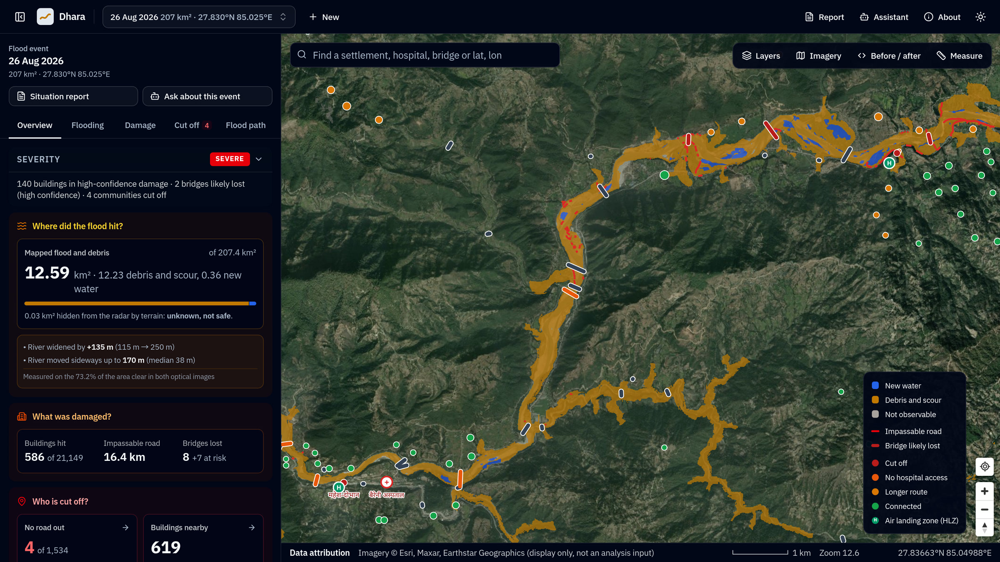
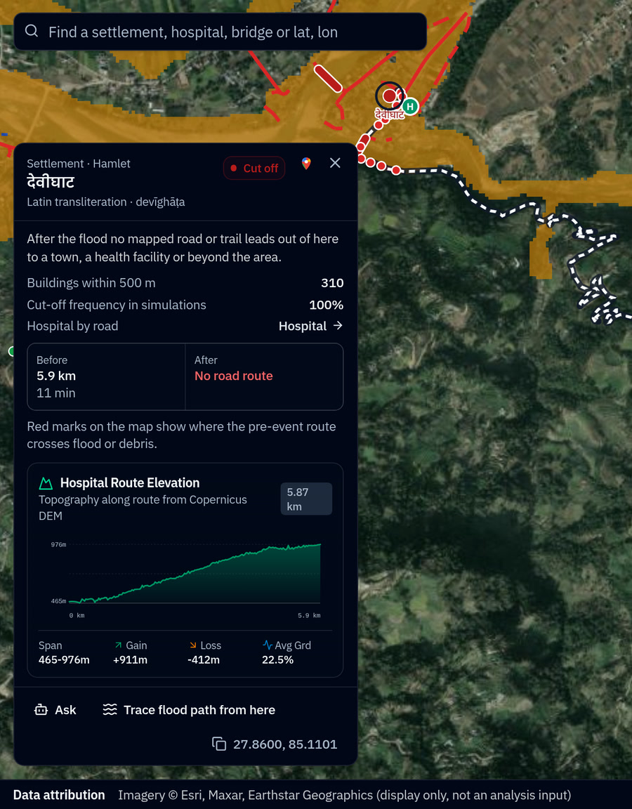
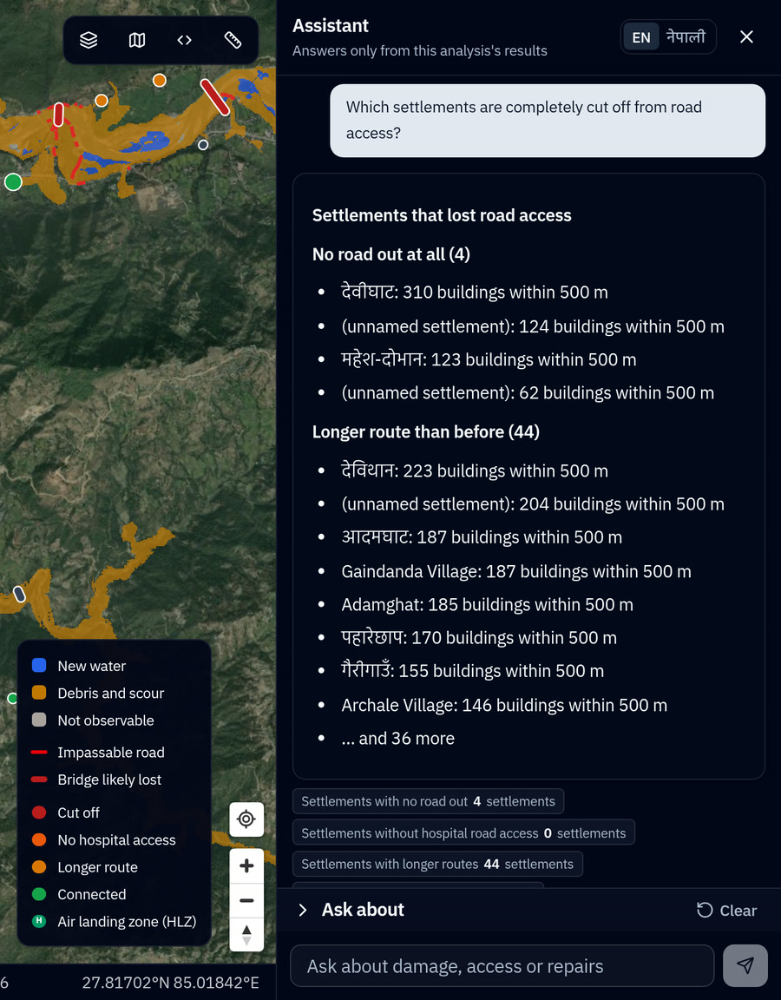
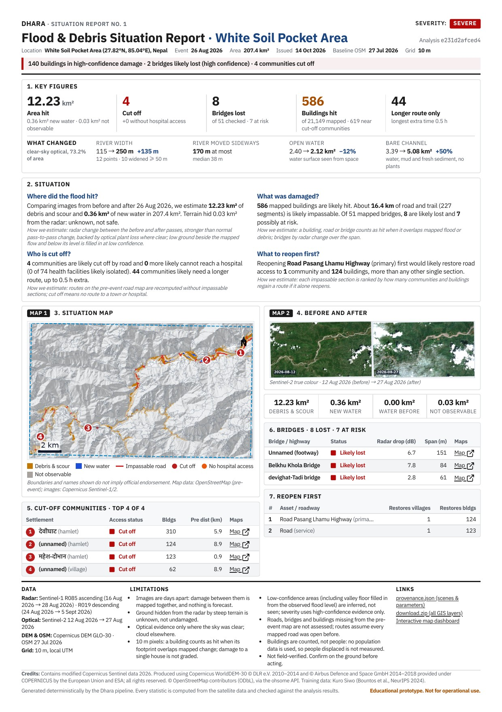
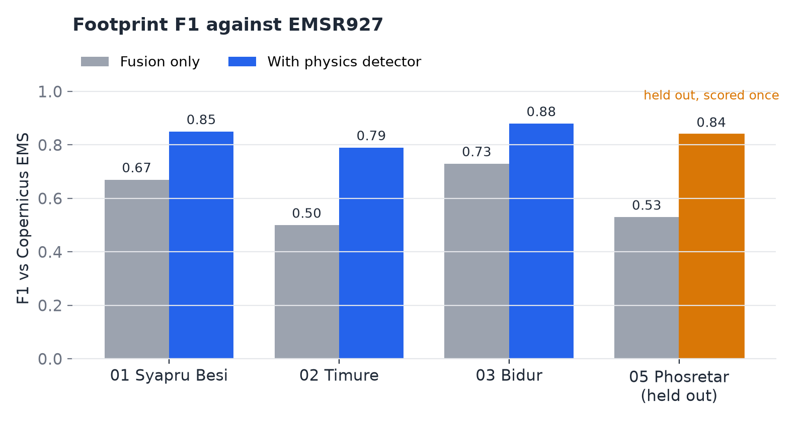

# Dhara

Dhara maps flood and debris-flow damage from open satellite data. For any area and event date it
answers three questions: **where did the flood hit, what was damaged, and who is cut off**. It
ends in a one-page situation report in English and Nepali.

Built for the Multimodal AI Hackathon 2026, Track B (Mapping Flood Damage from Space).
Dhara is an educational prototype, not for operational decisions.

Demo video: [YouTube](https://youtu.be/dUJkiYxDHBI)



## Contents

- [Overview](#overview)
- [Features](#features)
- [Results](#results)
- [Installation](#installation)
- [Model weights](#model-weights)
- [Usage](#usage)
- [Repository layout](#repository-layout)
- [Datasets](#datasets)
- [Testing](#testing)
- [Limitations](#limitations)
- [Citation and attribution](#citation-and-attribution)
- [License](#license)

## Overview

Monsoon floods and debris flows in mountain valleys happen under cloud, so optical satellites
often see nothing useful. Sentinel-1 radar sees through cloud, but steep terrain needs careful
processing, and a water map alone does not show which communities lost their road.

Dhara combines:

1. **Sentinel-1 radar**, processed from raw GRD files by its own chain (noise removal,
   calibration, speckle filter, terrain geocoding, terrain flattening, layover and shadow masks).
2. **Sentinel-2 optical**, where the sky is clear.
3. **Copernicus DEM GLO-30**, for height above the river, slope and flow paths.
4. **OpenStreetMap before the event**, for buildings, roads, bridges, settlements and hospitals.

Several detectors, including a U-Net trained on [Kuro Siwo](https://github.com/Orion-AI-Lab/KuroSiwo),
are fused per pixel with a confidence level. A physics-based detector keeps only what a flood can
do: stay low above the river and connect to the valley. The pre-event road network is then
rerouted to find who lost access.

```
Inputs ──> Own S1 chain + S2 + DEM ──> Detection ensemble ──> Physics detector
       ──> Damaged assets ──> Road rerouting ──> Dashboard, assistant, one-page report
```

Diagrams and stages: [`docs/architecture.md`](docs/architecture.md).

## Features

- **Three-question dashboard** with tabs for Flooding, Damage, Cut off and Flood path.
- **Confidence everywhere.** Ground the radar cannot see is shown as *not observable*, never as
  "no damage".
- **Before/after swipe** of optical and radar images, with river width and water edge measured
  on both sides.
- **Cut-off settlements.** Every settlement is routed to a town and a hospital before and after
  the event. Road repairs are ranked by the buildings they reconnect. Possible helicopter landing
  zones are marked.
- **Flood path** from any upstream point, with the settlements along it and rough arrival times.
- **Grounded assistant** in English and Nepali. Common questions are answered from precomputed
  facts. Other answers come from a language model and are kept only if every number in them is in
  the results.
- **One-page situation report** in English and Nepali, with a PDF built on the server when the
  analysis finishes.
- **Provenance.** Every job records scene IDs, git commit, parameters and timings.

| Who is cut off | Grounded assistant |
|---|---|
|  |  |

**Sample one-page situation report** for the 26 August 2026 event (Phosretar area), generated
by Dhara: [English PDF](docs/sample_report_en.pdf) · [Nepali PDF](docs/sample_report_ne.pdf)

<a href="docs/sample_report_en.pdf"></a>

## Results

Scored against Copernicus EMS rapid mapping of the 26 August 2026 Trishuli event
([EMSR927](https://rapidmapping.emergency.copernicus.eu/EMSR927)). EMS is used only for scoring,
never as an input. Method and caveats: [`validation/results.md`](validation/results.md).

| EMS area | Role | F1 (precision / recall) |
|---|---|---|
| 01 Syapru Besi | development | 0.85 (0.96 / 0.77) |
| 02 Timure | development | 0.79 (0.99 / 0.66) |
| 03 Bidur | development | 0.88 (0.81 / 0.95) |
| 05 Phosretar | **held out**, scored once with frozen settings | **0.84 (0.80 / 0.89)** |



- **Cut-off status** matches EMS-based routing for 127/127 settlements at Syapru Besi and 114/115
  at Timure.
- **Own Sentinel-1 chain** matches Sentinel Hub's processed products: σ⁰ VV per-pixel r 0.984,
  and the same system F1 (0.85 vs 0.85 at Syapru Besi).
- **Flood model** (`unet_r34_imagenet_v2`, deployed): test flood F1 0.74 and unseen mountain events
  0.75 on Kuro Siwo. Sen1Floods11 water IoU 0.61 (test) and 0.71 (Bolivia).

## Installation

Requirements: Python 3.12, [uv](https://docs.astral.sh/uv/), Node.js 20+ and
[pnpm](https://pnpm.io/), GDAL, curl.

### Quick setup

```bash
git clone https://github.com/adityabavadekar/dhara.git
cd dhara
scripts/setup.sh
```

[`scripts/setup.sh`](scripts/setup.sh) checks the prerequisites, installs the Python environment
and the dashboard, creates `.env` from [`.env.example`](.env.example), and downloads and verifies the
model weights. It is safe to run again. Options: `--no-web` (command line only), `--weights-only`.

### Manual setup

```bash
git clone https://github.com/adityabavadekar/dhara.git
cd dhara
uv sync
(cd web && pnpm install)
cp .env.example .env
```

Then download the [model weights](#model-weights).

### Copernicus Data Space account

A free [Copernicus Data Space](https://dataspace.copernicus.eu) account is needed to analyse a new
area or date. Finished analyses in `data/jobs/` open without it.

1. Register at [dataspace.copernicus.eu](https://dataspace.copernicus.eu).
2. In the [Sentinel Hub dashboard](https://shapps.dataspace.copernicus.eu/dashboard/), go to
   *User settings → OAuth clients → Create*, and copy the secret (it is shown once).
3. Add both values to `.env`:
   ```bash
   CDSE_SENTINEL_HUB_CLIENT_ID=...
   CDSE_SENTINEL_HUB_CLIENT_SECRET=...
   ```

Optional keys (S3 access for the raw radar chain, ohsome, the assistant's language model) are
listed in [`.env.example`](.env.example).

## Model weights

The flood model (`unet_r34_imagenet_v2`, 98 MB, ONNX) is on Hugging Face:
[adityabavadekar/dhara-flood-unet](https://huggingface.co/adityabavadekar/dhara-flood-unet).
`scripts/setup.sh` downloads it. To download it on its own:

```bash
scripts/setup.sh --weights-only
```

or by hand:

```bash
curl -L -o models/flood_unet/model.onnx https://huggingface.co/adityabavadekar/dhara-flood-unet/resolve/main/model.onnx
```

The file goes in `models/flood_unet/`, next to `model_card.json` and `norm.json` (already in the
repository). Without the weights the pipeline runs without the model; the job's provenance lists
which detectors ran. Training code and configs are in [`training/`](training/); training ran on
Kaggle GPUs.

## Usage

**Dashboard**

```bash
uv run dhara serve          # API on http://localhost:8000 (docs at /docs)
cd web && pnpm dev          # dashboard on http://localhost:5173
```

Open a specific analysis with `http://localhost:5173/?job=<job_id>`.

**Command line**

```bash
# Before/after Sentinel-1 and Sentinel-2 pairs for an area and date
uv run dhara scenes --bbox 85.0,27.8,85.1,27.9 --event 2026-08-26

# Full analysis; outputs go to data/jobs/<job_id>/
uv run dhara run --bbox 85.0,27.8,85.1,27.9 --event 2026-08-26
```

Options: `--no-s2` (radar only), `--no-ml` (no segmentation model), `--orbit N` (one track),
`--s1-source sentinelhub` (server-side radar processing instead of the own chain),
`--s2-max-post-days N`, `--geojson FILE` (area as a polygon).

## Repository layout

| Path | Contents |
|---|---|
| [`src/dhara/adapters/`](src/dhara/adapters/) | All network access, through one allowlist |
| [`src/dhara/sar/`](src/dhara/sar/) | Own Sentinel-1 GRD processing chain |
| [`src/dhara/members/`](src/dhara/members/) | Radar, optical and model detectors |
| [`src/dhara/fusion/`](src/dhara/fusion/) | Per-pixel fusion and the physics-based detector |
| [`src/dhara/network/`](src/dhara/network/) | Road graph, cut-off settlements, repair ranking |
| [`src/dhara/sitrep/`](src/dhara/sitrep/) | Facts ledger and the one-page report |
| [`src/dhara/assistant/`](src/dhara/assistant/) | Grounded assistant |
| [`web/`](web/) | Dashboard (React, shadcn/ui, MapLibre) |
| [`scripts/`](scripts/) | Setup script and report tools |
| [`training/`](training/) | Model training and evaluation |
| [`validation/`](validation/) | Scoring against EMS (kept out of `src/`) |

## Datasets

| Dataset | Use | License |
|---|---|---|
| [Sentinel-1 GRD](https://dataspace.copernicus.eu/explore-data/data-collections/sentinel-data/sentinel-1) | Input | [Copernicus open licence](https://sentinels.copernicus.eu/documents/247904/690755/Sentinel_Data_Legal_Notice) |
| [Sentinel-2 L2A](https://dataspace.copernicus.eu/explore-data/data-collections/sentinel-data/sentinel-2) | Input | Copernicus open licence |
| [Copernicus DEM GLO-30](https://dataspace.copernicus.eu/explore-data/data-collections/copernicus-contributing-missions/collections-description/COP-DEM) | Input | Copernicus DEM licence |
| [OpenStreetMap](https://www.openstreetmap.org/copyright) via [ohsome](https://api.ohsome.org/) | Input, snapshot 2026-07-27 | ODbL |
| [Kuro Siwo](https://github.com/Orion-AI-Lab/KuroSiwo) | Training | CC BY |
| [Sen1Floods11](https://github.com/cloudtostreet/Sen1Floods11) | Evaluation | CC BY 4.0 |
| [Copernicus EMS EMSR927](https://rapidmapping.emergency.copernicus.eu/EMSR927) | Scoring only | Copernicus EMS terms |

## Testing

```bash
uv run pytest                                                      # all tests
uv run ruff check . && uv run ruff format --check . && uv run ty check
```

## Limitations

- A map can only follow the first Sentinel-1 pass after the event; each track repeats every
  12 days per satellite.
- At 10 m, single houses are 1–2 pixels; damage is reliable for clusters and roads, not for
  individual roofs.
- Steep shadow and layover are not observable by radar and are reported as such.
- Population is not an input, so Dhara never reports numbers of people.

## Citation and attribution

- Contains modified Copernicus Sentinel data 2026.
- Produced using Copernicus WorldDEM-30 © DLR e.V. 2010–2014 and © Airbus Defence and Space GmbH
  2014–2018 provided under COPERNICUS by the European Union and ESA; all rights reserved.
- © OpenStreetMap contributors (ODbL), via the HeiGIT ohsome API.
- Bountos et al., *Kuro Siwo: 33 billion m² under the water. A global multi-temporal satellite
  dataset for rapid flood mapping*, NeurIPS 2024 Datasets and Benchmarks.
- Bonafilia et al., *Sen1Floods11: A georeferenced dataset to train and test deep learning flood
  algorithms for Sentinel-1*, CVPR Workshops 2020.
- Copernicus Emergency Management Service, activation EMSR927.

## License

Code: [MIT](LICENSE). Data and model outputs follow the licences of the datasets above.

This is an educational prototype. It is not an official product and must not be used for
operational decisions.
