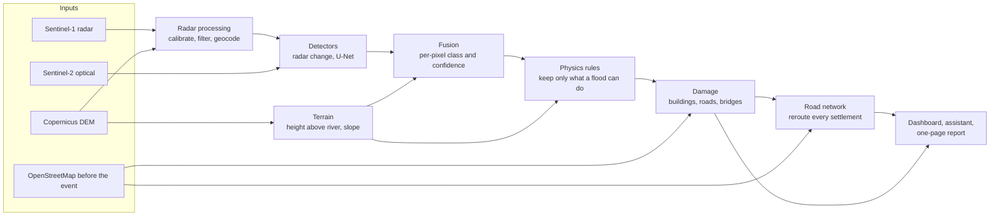
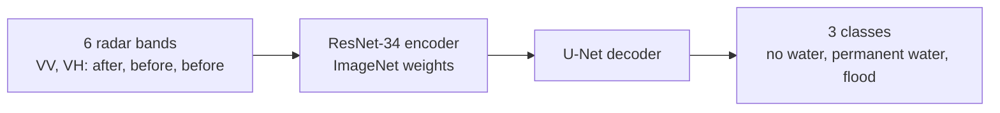

# Architecture

Dhara turns satellite images taken before and after an event into three answers: where the flood
hit, what was damaged, and who is cut off.

## Stages

| Stage | Code | What it does |
|---|---|---|
| Radar processing | `src/dhara/sar/` | Reads raw Sentinel-1 GRD files: noise removal, calibration, speckle filter, terrain geocoding, terrain flattening, layover and shadow masks |
| Terrain | `src/dhara/terrain/` | Height above the nearest river and slope, from the Copernicus DEM |
| Detectors | `src/dhara/members/` | Radar water and change, optical water and debris, and the flood U-Net |
| Fusion | `src/dhara/fusion/fuse.py` | Combines the detectors into flood, debris, no change or not observable, with a confidence level |
| Physics rules | `src/dhara/fusion/detector.py` | Removes water too high above the river or on steep slopes, keeps debris connected to the river, fills the valley floor up to the mapped flood level |
| Damage | `src/dhara/damage/` | Marks buildings, roads and bridges inside the footprint |
| Road network | `src/dhara/network/` | Routes each settlement to a town and a hospital before and after the event, and ranks repairs |
| Outputs | `src/dhara/api/`, `src/dhara/sitrep/`, `src/dhara/assistant/`, `web/` | Dashboard, grounded assistant and one-page report in English and Nepali |

## Physics rules

Fusion judges each pixel on its own. A flood or debris flow is one connected body that follows the
valley, so `src/dhara/fusion/detector.py` then applies these rules, using height above the nearest
river (HAND) and slope from the Copernicus DEM:

| Rule | What it does |
|---|---|
| Terrain gate | Removes water more than 25 m above the river or on slopes over 25°, and debris more than 55 m or over 50° |
| Specks | Removes isolated patches under 12 pixels (radar noise at 10 m) |
| Corridor | Keeps debris only if it connects to the main river network; hillside change is usually not flood |
| Valley-floor fill | Within each 500 m reach, reads the flood level from the mapped footprint and fills connected low ground below it, within 250 m, including ground the radar could not see |
| Swept channel | Marks the river channel inside a covered reach as swept by the same flow |
| Landslide scars | Restores steep debris that runs continuously into the footprint (source and deposit of one flow) |

Anything filled in or restored keeps low confidence: it is inferred, not observed. With the rules
frozen before the held-out test (all but landslide scars, added later), the score against
Copernicus EMS on the held-out area rose from 0.53 to 0.84 ([validation](../validation/results.md)).

## Flood model

- Trained on Kuro Siwo, with mountain events held out by terrain relief.
- Exported to ONNX and run on CPU.
- Weights: [huggingface.co/adityabavadekar/dhara-flood-unet](https://huggingface.co/adityabavadekar/dhara-flood-unet).
