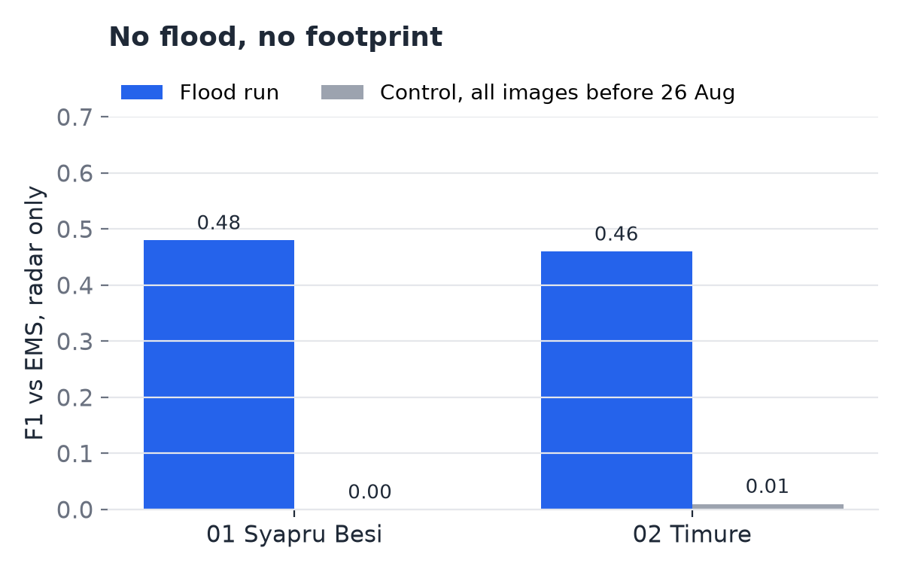
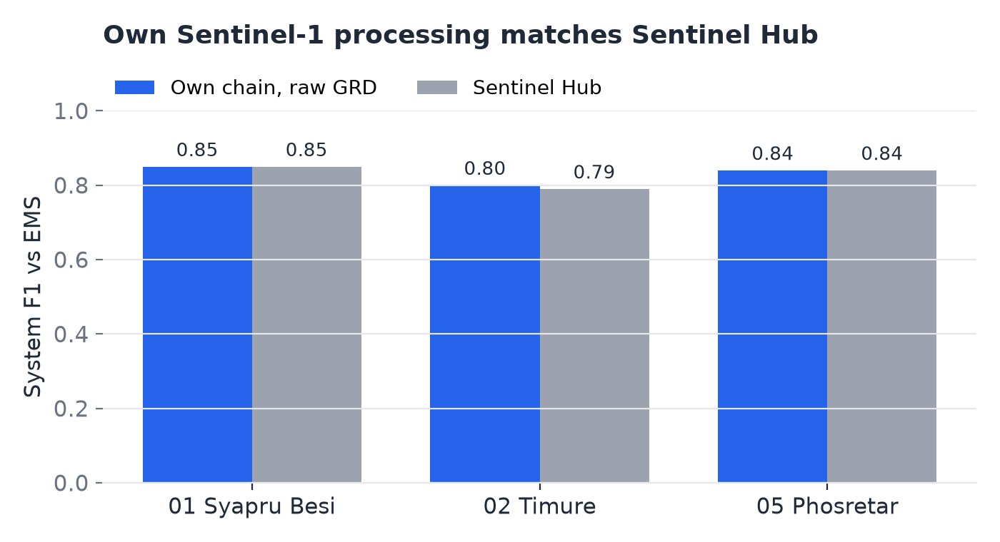
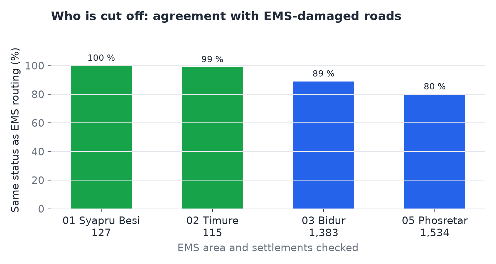
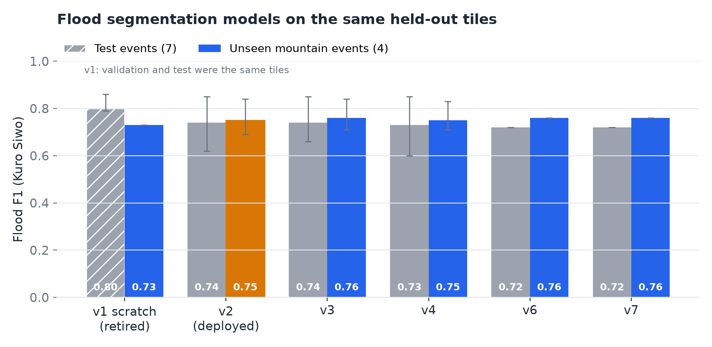
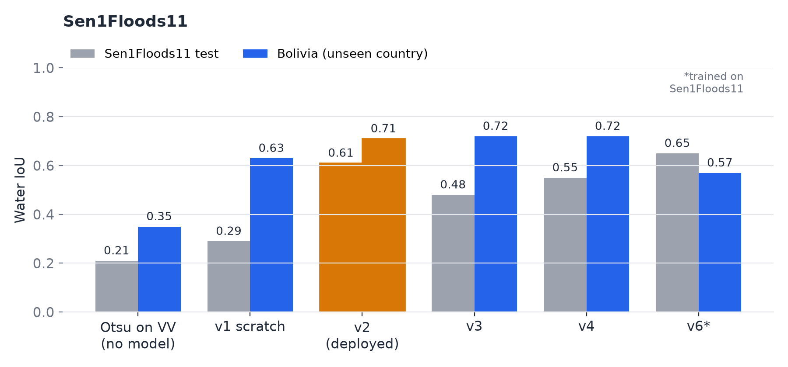
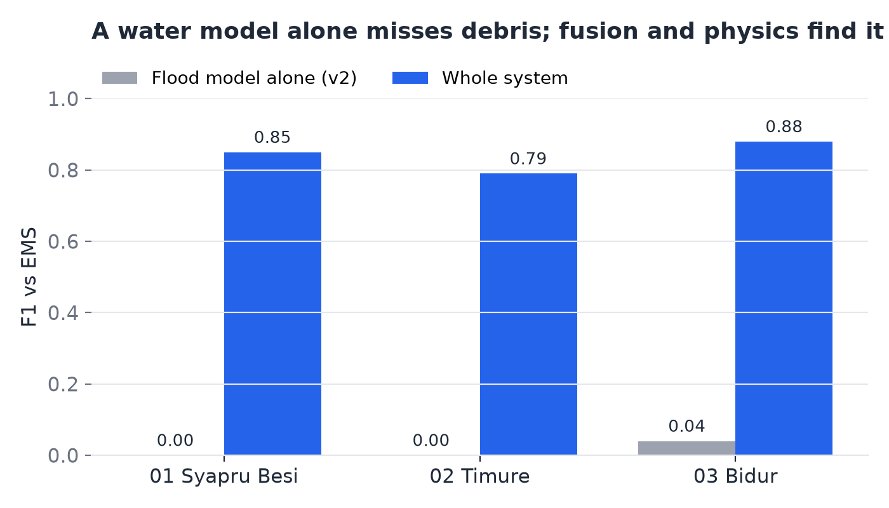

# How well does Dhara work?

We checked Dhara's maps against official maps made by experts after the 26 August 2026 flood in
Nepal. The expert maps are used **only to check** our results. Dhara never reads them
(`src/dhara` cannot even mention them, and a test enforces this).

The scripts in this folder produced every number here. `plot_results.py` draws the charts.

## In short

| Question | Answer |
|---|---|
| Does Dhara find the flood where the experts found it? | Yes. Score **0.84** out of 1 on an area we never tuned on |
| Does it get "who is cut off" right? | 127 of 127 settlements match in one valley, 114 of 115 in another |
| Is our own radar processing as good as a ready-made service? | Yes, same scores |
| Does the flood model work on mountains it never saw? | Score 0.75 out of 1 |

## Words used here

- **EMS:** the European Union's Copernicus Emergency Management Service. After a disaster, its
  experts draw damage maps from very sharp satellite photos. Their maps of this flood
  (called **EMSR927**) are our answer key.
- **Score (F1):** how well our map matches the expert map, from 0 (no match) to 1 (perfect).
  It balances two things:
  - **Precision:** of what we marked as flooded, how much really was.
  - **Recall:** of what really flooded, how much we found.
- **Held out:** an area we did not look at while building Dhara, so its score is a fair test.
- **Control:** a test run using only images from **before** the flood. A good system should find
  almost nothing there.

## The four areas

EMS mapped four stretches of the Trishuli river valley north-west of Kathmandu, from the Chinese
border down towards the plains:

| Area | Where | Our role for it |
|---|---|---|
| 01 Syapru Besi | upper valley, a town near the Chinese border (28.13–28.19° N, 85.32–85.36° E) | used to build Dhara |
| 02 Timure | top of the valley, at the border crossing (28.25–28.30° N, 85.35–85.40° E) | used to build Dhara |
| 03 Bidur | lower valley, a district town (27.8–28.1° N, 85.1–85.35° E) | used to build Dhara |
| 05 Phosretar | further down the valley (27.78–27.88° N, 84.93–85.12° E) | **held out**, tested once |

EMS also planned areas 04 and 06, but cancelled them because of cloud.

## 1. Does Dhara find the flood?

Dhara combines several detectors, then applies simple physical rules. For example, flood water
cannot sit high above the river, and debris must connect to the river. These rules made the
biggest difference:

| Area | Without the rules | With the rules |
|---|---:|---:|
| 01 Syapru Besi | 0.67 | 0.85 |
| 02 Timure | 0.50 | 0.79 |
| 03 Bidur | 0.73 | 0.88 |
| **05 Phosretar, held out** | 0.53 | **0.84** |

**The fair test.** We fixed all settings first, then ran Phosretar once. It scored **0.84**
(precision 0.80, recall 0.89). 76 % of the buildings EMS marked as damaged were within 20 m of our
map. Small improvements made later give 0.85 there, but 0.84 is the honest number to quote.

**The control test.** With only pre-flood images, Dhara finds almost nothing, so it is finding
the flood and not just painting the valley. The chart uses radar only, because no clear optical
image exists between 14 and 25 August (monsoon cloud):

## 2. Is our own radar processing good enough?

Dhara processes the raw Sentinel-1 radar files itself instead of using ready-made images. On the
same satellite pass, our images match Sentinel Hub's (a widely used processing service) almost
exactly: correlation 0.984, an average offset of 0.07 dB. The whole system scores the same with
either:

## 3. Does it get "who is cut off" right?

We ran Dhara's road routing twice: once with the roads **our** map says are damaged, once with
the roads **EMS** marked as damaged. Then we compared each settlement's result (cut off, longer
route, or still connected):

| Area | Settlements | Same answer |
|---|---:|---:|
| 01 Syapru Besi | 127 | 100 % |
| 02 Timure | 115 | 99 % |
| 03 Bidur | 1,383 | 89 % |
| 05 Phosretar | 1,534 | 80 % |

In the narrow upper valley, the answers match almost exactly. In the wider lower valley, our map
marks some roads as damaged that EMS saw as fine. There we say "longer route" where EMS says
"connected": the mistake errs on the side of caution.

## 4. The flood model

Part of Dhara is a neural network (a U-Net) trained on **Kuro Siwo**, a public flood dataset. To
test it fairly, we kept whole flood events out of training. That included the 4 most mountainous
ones, picked before training started.

- **v2 is the model Dhara uses.** It scores 0.74 on new flood events and 0.75 on unseen
  mountains.
- **v1 looked better (0.80), but it cheated by accident.** Its test images were also in its
  training data, so we retired it.
- The other versions scored about the same as v2.
- For comparison, the Kuro Siwo paper's best model scores 0.80.

The rules require scoring it on a second dataset, **Sen1Floods11**, too. "Bolivia" is a country
none of the models trained on:

**The model alone is not enough for this flood.** Kuro Siwo and Sen1Floods11 only label water.
This event was mostly mud and debris, so on its own the model finds almost none of it. Combining
it with the other detectors and the physical rules is what works:

## 5. Other checks

- **Global water maps (JRC).** The organisers allow JRC's map of where water usually is, if we
  compare it. On these narrow rivers it shows only about a fifth of the water our pre-flood
  images show, and it changes the score by at most 0.02. We do not use it.
- **Building damage map from HDX.** A separate damage map found almost all its damaged buildings
  inside our flood area (84–99 %). Over a wide area with no flood, our precision drops to 0.16,
  so radar on steep hillsides is the main source of false alarms. The physical rules address that.
- **Ideas that did not help,** and are switched off: comparing against several older radar
  images, and tuning radar thresholds on the valley floor only. Neither improved the score.

## Why radar finds this flood hard

Mud and rocks on a riverbed that was already rough look much the same to radar. Only about one
in seven pixels inside the expert flood area changes strongly in the radar images. That is why
Dhara combines several detectors with physical rules, and does not trust any single one.
